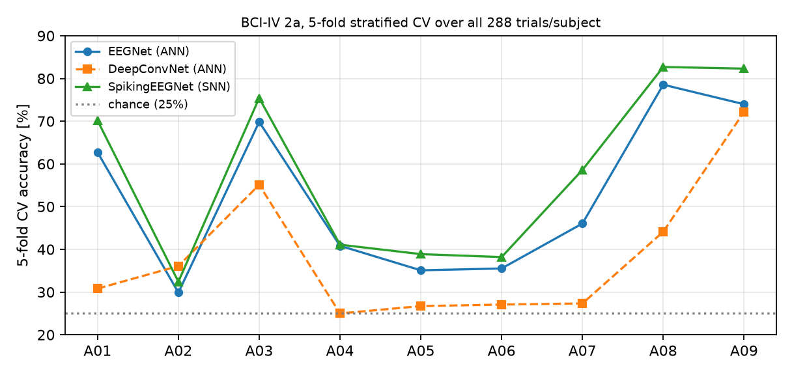

# eeg-decoding-snn — BCI-IV 2a decoding with ANN and spiking models

Decoding four-class motor imagery from the **BCI Competition IV-2a** dataset
(9 subjects, 22 EEG channels, 288 trials each): a compact PyTorch pipeline
with two non-spiking baselines and one spiking network, trained under a fixed
protocol and evaluated under both a holdout split and 5-fold stratified
cross-validation. Chance level is 25 %.

## Results at a glance

**5-fold stratified CV over all 288 trials** (the literature protocol):

| Model | mean ± std over subjects | best subjects |
|---|---|---|
| EEGNet (ANN) | 52.5 ± 17.7 % | A08 78.5, A09 74.0 |
| DeepConvNet (ANN) | 38.3 ± 15.2 % | A09 72.2 |
| **SpikingEEGNet** | **57.8 ± 19.3 %** | **A08 82.7 ± 3.2, A09 82.3 ± 1.3** |



**The spiking model outperforms the ANN EEGNet on every one of the 9
subjects** (+5.3 pt mean), with remarkable fold stability on the best
subjects (A09 ± 1.3 %). Holdout reference (75/25 split): EEGNet 47.5 ± 16.6,
DeepConvNet 38.4 ± 15.9, SpikingEEGNet 56.8 ± 22.1 (best subjects up to
84.7 %). Published within-session means (~65-75 %) typically use heavier
calibration pipelines; the gap and the next levers are documented in
`results/RESULTS.md`.

## Models

| Model | Type | Size |
|---|---|---|
| EEGNet | ANN (Lawhern et al. 2018) | ~2.9 k params |
| DeepConvNet | ANN (Schirrmeister et al. 2017) | ~50 k |
| **SpikingEEGNet** | SNN — conv → LIF stack over T=8 timesteps, sigmoid surrogate gradients, pure PyTorch (no SNN framework) | ~3.3 k |

Protocol: per-channel z-score (train stats only), stratified splits, Adam
+ gradient clipping, per-subject training, early stopping on validation.
Device: Windows-native **torch-directml** (AMD RX 6750 GRE) — EEGNet 5-fold
CV runs in ~20 min on GPU.

## Results (all runs in `results/`, log in `results/RESULTS.md`)

**5-fold stratified CV over all 288 trials** (the literature protocol):

| Model | mean ± std over subjects | best subjects |
|---|---|---|
| EEGNet | 52.5 ± 17.7 % | A08 78.5, A09 74.0 |
| DeepConvNet | 38.3 ± 15.2 % | A09 72.2 |
| **SpikingEEGNet** | **57.8 ± 19.3 %** | **A08 82.7 ± 3.2, A09 82.3 ± 1.3** |

The spiking model **outperforms the ANN EEGNet on every one of the 9
subjects** (+5.3 pt mean) and shows exceptional fold stability on the best
subjects (A09 ± 1.3 %). Holdout reference (75/25 split): EEGNet 47.5 ± 16.6,
DeepConvNet 38.4 ± 15.9, SpikingEEGNet 56.8 ± 22.1 (best subjects up to
84.7 %). Published within-session means (~65-75 %) typically use heavier
calibration pipelines; the gap and the next levers are documented in
`results/RESULTS.md`.

## The neuromorphic connection

Spike-domain compute is the native coding style of memristive neuromorphic
hardware. This decoder shares its dataset, protocol and evaluation with the
[memristor-qat-cim-sim](https://github.com/004Tingting/memristor-qat-cim-sim)
repository (quantization-aware training for memristive in-memory computing) —
the two projects bracket the same question, *what does non-ideal, low-precision
compute do to learned models*, from the training side and the coding side.

## Reproduce

```bash
pip install torch torchvision numpy scipy matplotlib
python src/preprocess.py                    # build the NPZ cache from the GDFs
python src/train_subjects.py --model eegnet --device dml --cv kfold5
python src/train_subjects.py --model spkieeg --device dml
```

Dataset: BCI Competition IV-2a (public, bbci.de); raw GDFs are not included.

## Origin & scope

A self-directed project (started 2026-10) bridging physiological-signal
decoding and neuromorphic computing. Future work: session-T → session-E
evaluation with the official labels, per-subject tuning, and SNN depth /
timestep sweeps.
